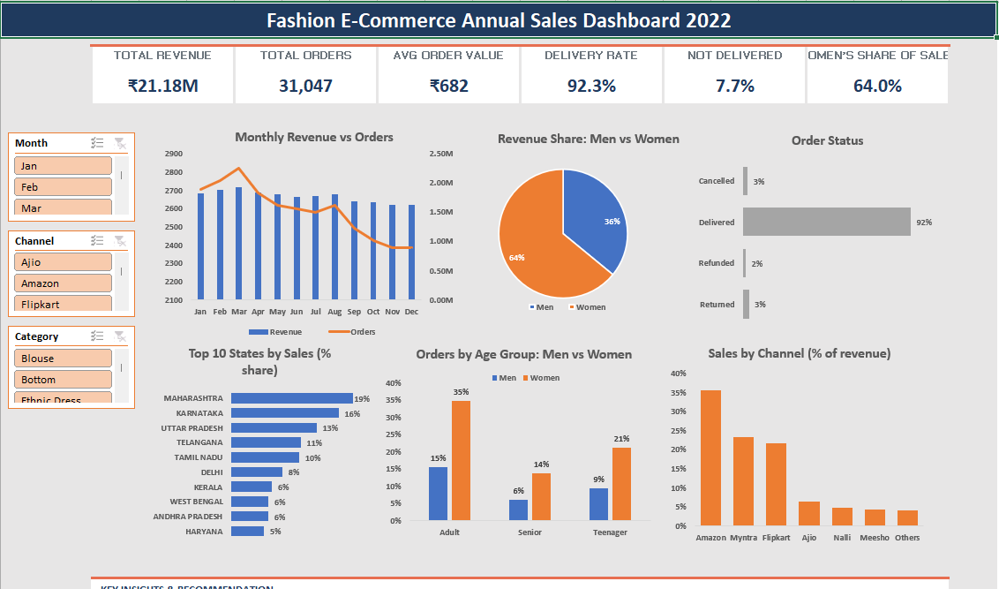

# Fashion E-Commerce Annual Sales Dashboard

An interactive Excel dashboard that analyzes a full year (2022) of online fashion sales across Indian marketplaces. It turns 31,047 order records into KPI cards, six linked charts, and a short list of business insights, with slicers so any month, channel, or category can be explored in one click.

> Add a screenshot of the dashboard (taken from Excel) to this repo as `dashboard.png`.

## Business Problem

An online fashion seller needs a clear view of where revenue comes from and where it leaks. This dashboard answers:

- How does revenue and order volume change month to month?
- Which categories, channels, and states drive the most sales?
- Who is buying: men or women, and which age groups?
- How many orders are delivered, and how many are lost to returns, cancellations, or refunds?

## Dashboard Features

- **KPI cards:** Total Revenue, Total Orders, Average Order Value, Delivery Rate, Not Delivered rate, and Women's Share of Sales.
- **Monthly Revenue vs Orders:** trend of revenue and order count across the year.
- **Revenue Share, Men vs Women:** gender split of sales.
- **Order Status:** delivered, returned, refunded, and cancelled orders.
- **Top 10 States by Sales:** sorted bar chart of the leading states.
- **Orders by Age Group:** men vs women across age groups.
- **Sales by Channel:** share of revenue by marketplace.
- **Slicers:** filter the dashboard by Month, Channel, and Category.
- **Key Insights box:** findings and a recommendation written from the data.

## Key Insights

- Revenue is steady at about ₹1.6M to ₹1.9M a month, peaking in March (₹1.93M) and dipping to its low in November (₹1.62M).
- Sets are the top category at about 50% of revenue, followed by Kurtas at about 23%.
- Women generate about 64% of revenue and 69% of orders.
- Amazon, Myntra, and Flipkart together drive about 80% of sales; every other channel is below 7%.
- The top 3 states (Maharashtra, Karnataka, Uttar Pradesh) contribute about 48% of top-10-state sales.
- 92% of orders are delivered; returns (3.4%), cancellations (2.7%), and refunds (1.7%) make up the remaining ~8%.

## Recommendation

Focus inventory and ad spend on Sets and Kurtas, target women shoppers, concentrate on Amazon, Myntra, and Flipkart in the top 3 states, and investigate the causes of returns and cancellations to protect revenue.

## Tools and Skills

- **Microsoft Excel:** Pivot Tables, Pivot Charts, Slicers, GETPIVOTDATA, KPI cards
- **Data analysis:** trend analysis, segmentation (gender, age group, channel, state, category), KPI reporting
- **Data storytelling:** turning findings into insights and recommendations

## Files

| File | Description |
|---|---|
| `Fashion_Ecommerce_Sales_Dashboard.xlsx` | The workbook: raw data (`Sales Data`), pivot table sheets, and the `Dashboard` sheet |
| `dashboard.png` | Screenshot of the finished dashboard |

## How to Use

1. Download `Fashion_Ecommerce_Sales_Dashboard.xlsx` and open it in Microsoft Excel (2010 or later; slicers are not supported in older versions).
2. Go to the **Dashboard** sheet.
3. Click the **Month**, **Channel**, or **Category** slicers to filter the charts and KPI cards.
4. The **Sales Data** sheet holds the raw records, and each pivot table sheet holds the summary behind one chart.

## Notes

- "Total Orders" counts order records (31,047 rows); some orders contain more than one line item, so the number of unique order IDs is lower (28,471).
- The Key Insights text describes the full year and does not change when slicers are applied. The KPI cards and charts do.
- The Men vs Women, Channel, and Top 10 States charts show percentage shares, not absolute values. The Top 10 States chart shows each state's share of the top-10 total.

## Author

**Amisha Verma**, Data Analyst
[LinkedIn](https://linkedin.com/in/amisha-verma543) | [GitHub](https://github.com/Amisha-verma2907)
